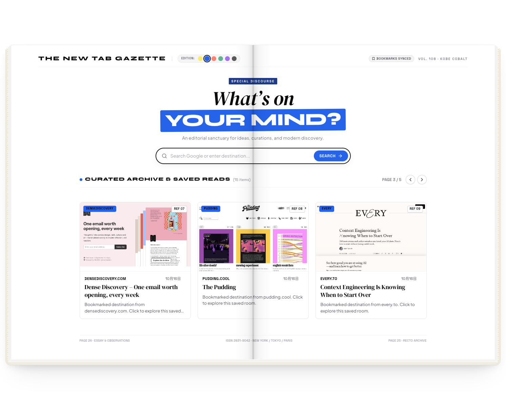
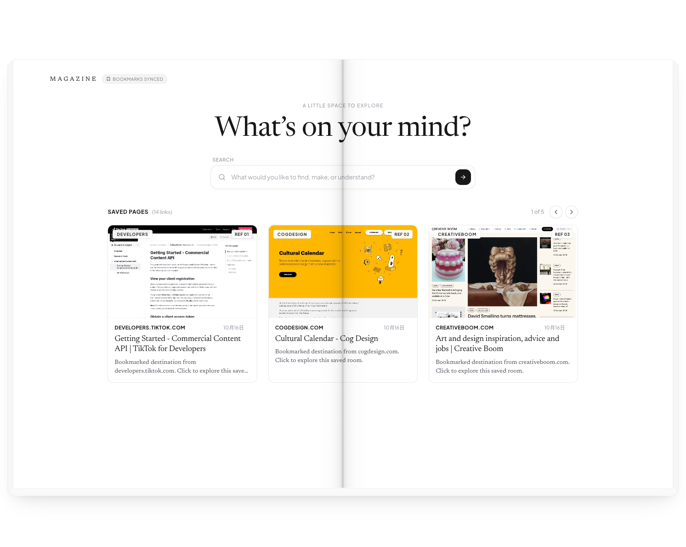

[English](README.md) · [中文](README.zh-CN.md)
# 📖 Magazine New Tab - Chrome Extension (Manifest V3)
**Turn your new tab into a magazine.**
What if your favorite websites became illustrations in your own digital magazine?
Magazine New Tab reimagines the browser's new tab as a visual playground, turning your favorite websites into part of a magazine-inspired experience.
## 🎨 01 — Vibrant
1.A colorful, playful take on your new tab, full of energy and visual expression.  
2.You can switch colors by clicking the dots at the top.

**Demo:** [Watch Vibrant Demo](https://github.com/user-attachments/assets/5d0b67e6-c67a-428e-83e1-185ff13dfe76)
## 📰 02 — Editorial
A magazine-inspired experience shaped by typography, thoughtful layouts, and visual storytelling.

**Demo:** [Watch Editorial Demo](https://github.com/user-attachments/assets/e2af9725-ee11-4fd3-ba3f-b34fdc3eb731)
## 🚀 Installation on macOS Chrome
1. Download or clone this repository.
2. Open `chrome://extensions/` in Google Chrome.
3. Enable **Developer mode**.
4. Click **Load unpacked**.
5. Select the `vibrant/` or `editorial/` folder.
Open a new tab and enjoy! 🥰
